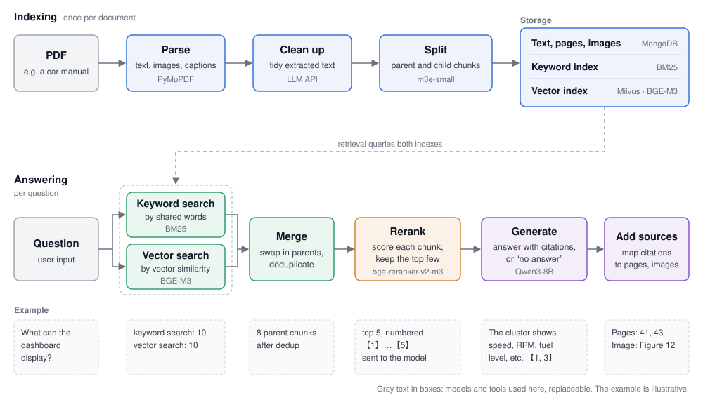

<p align="right"><a href="README.md">简体中文</a> | English</p>

# a-rag-demo

A RAG system that answers questions about a PDF document. The pipeline covers PDF parsing, keyword search, vector search, reranking and generation; training covers fine-tuning the reranker and the generation model.



## Pipeline

**Indexing** (`build_index.py`, simplified)

```python
raw_docs = load_pdf()                     # extract text, images and captions from each page
clean_docs = request_llm_clean(raw_docs)  # tidy the extracted text with an LLM
split_docs = texts_split(clean_docs)      # split into parent and child chunks, store in MongoDB
BM25(split_docs)                          # build the keyword index
MilvusRetriever(split_docs)               # build the vector index
```

**Answering** (`infer.py`, simplified)

```python
bm25_docs = bm25.retrieve_topk(query, topk=10)      # keyword search
milvus_docs = milvus.retrieve_topk(query, topk=10)  # vector search
candidates = merge_docs(bm25_docs, milvus_docs)     # swap in parent chunks, deduplicate
ranked = reranker.rank(query, candidates, topk=5)   # rerank, keep the most relevant few

# number the chunks 【1】【2】…, let the LLM answer, then map the cited numbers back to pages and images
context = "\n".join(f"【{i + 1}】{d.page_content}" for i, d in enumerate(ranked))
answer = post_processing(request_chat(query, context), ranked)
```

Child chunks are matched against the question, which is more precise; the model receives their parent chunks, which carry fuller context.

- **Parsing rules**: the page range (skipping the cover and table of contents) and footer height at the top of `src/parser/pdf_parse.py`, and the caption position and format in `src/parser/image_handler.py` (currently: text below the image starting with “图” plus a number). Adjust them to your document's layout.
- **Prompts**: in `src/client/`, `src/gen_qa/run.py` and `scripts/generate_sft_data.py`, written in Chinese. Adjust them to your document and task.
- **Tokenization**: keyword search segments Chinese text with jieba (`src/retriever/bm25_retriever.py`). Change it for other languages or needs.

## Setup

Requires a CUDA GPU, MongoDB and an OpenAI-compatible LLM API. Put the models shown in the diagram under `models/` (paths in `src/constant.py`) and a stopword list at `data/stopwords.txt`. Milvus runs from a local file.

```bash
pip install -r requirements.txt
pip install vllm==0.9.0.1                # for serving the generation model
export RAG_PDF_PATH=data/manual.pdf
export DOUBAO_API_KEY=... DOUBAO_BASE_URL=... DOUBAO_MODEL_NAME=...   # LLM API for cleaning text and generating training data

python -m src.server.semantic_chunk &    # start the chunking service
python build_index.py                    # build the index
bash training/vllm_serve.sh &            # serve the generation model; RAG_MODEL_DIR sets the model directory
python infer.py                          # ask questions in the terminal; RAG_RERANKER_PATH sets the reranker
```

## Training and evaluation

### Training

The reranker and the generation model are fine-tuned on data an LLM generates from the document:

1. `src/gen_qa/run.py`: writes questions and answers for each page, paraphrases each question several times to expand the data, then splits it into training and test sets. It also reads small-talk sentences from `data/ut/raw_general_chats.txt` as questions the document can't answer, with the answer “无答案” (no answer).
2. `scripts/generate_sft_data.py`: runs retrieval for each training question and ranks the results with a larger reranker; the rankings become the reranker's training data. An LLM then writes answers with citation numbers from the ranked passages, which become the generation model's training data. On the first run, set `RUN_RAG_GENERATION` in the file to `True`.

- **Reranker**: fine-tuned with [RAG-Retrieval](https://github.com/NLPJCL/RAG-Retrieval).
- **Generation model**: LoRA fine-tuned with [LLaMA-Factory](https://github.com/hiyouga/LLaMA-Factory), quantized to 4-bit with [AutoAWQ](https://github.com/casper-hansen/AutoAWQ), served with [vLLM](https://github.com/vllm-project/vllm).

Training configs are in `training/config/`.

### Evaluation

- Retrieval and reranking: Hit / Recall / MRR / NDCG. `reranker_score.py`
- Answer quality: semantic similarity to the reference answer, keyword coverage, and [RAGAS](https://github.com/explodinggradients/ragas) metrics. `final_score.py`
- Serving speed: requests per second and average latency. `training/benchmark.py`
