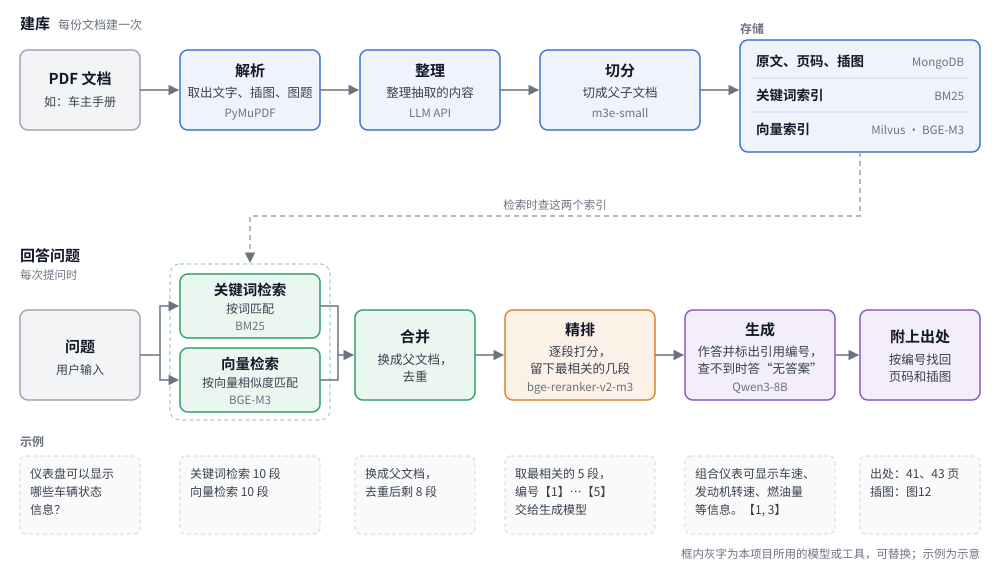

<p align="right">简体中文 | <a href="README.en.md">English</a></p>

# a-rag-demo

一个根据 PDF 文档回答问题的 RAG 系统：流程含 PDF 解析、关键词检索、向量检索、精排、生成，训练含微调排序模型、生成模型。



## 流程

**建库**（`build_index.py`，简化）

```python
raw_docs = load_pdf()                     # 取出每页的文字、插图和图题
clean_docs = request_llm_clean(raw_docs)  # 调用大模型整理抽取内容
split_docs = texts_split(clean_docs)      # 切成父子文档，存入 MongoDB
BM25(split_docs)                          # 建关键词索引
MilvusRetriever(split_docs)               # 建向量索引
```

**回答问题**（`infer.py`，简化）

```python
bm25_docs = bm25.retrieve_topk(query, topk=10)      # 关键词检索
milvus_docs = milvus.retrieve_topk(query, topk=10)  # 向量检索
candidates = merge_docs(bm25_docs, milvus_docs)     # 换成父文档，去重
ranked = reranker.rank(query, candidates, topk=5)   # 精排，留下最相关的几段

# 给每段编号【1】【2】…，交给大模型作答，再按回答里的编号找回页码和插图
context = "\n".join(f"【{i + 1}】{d.page_content}" for i, d in enumerate(ranked))
answer = post_processing(request_chat(query, context), ranked)
```

检索时用子文档匹配问题，匹配得更准；交给模型时换成父文档，内容更完整。

- **解析规则**：`src/parser/pdf_parse.py` 开头的页码范围（跳过封面、目录）和页脚高度，`src/parser/image_handler.py` 里图题的位置和格式（现在找的是图片下方、以“图＋数字”开头的文字），视文档版式修改。
- **prompt**：`src/client/`、`src/gen_qa/run.py` 和 `scripts/generate_sft_data.py` 里的 prompt 视文档、任务需求修改。
- **分词**：关键词检索用 jieba 做中文分词（`src/retriever/bm25_retriever.py`），视语言、任务需求修改。

## 安装与运行

需要 CUDA GPU、MongoDB 和一个 OpenAI 兼容的大模型接口。图中各模型放在 `models/` 下（路径见 `src/constant.py`），停用词表放在 `data/stopwords.txt`。Milvus 用本地文件。

```bash
pip install -r requirements.txt
pip install vllm==0.9.0.1                # 部署生成模型用
export RAG_PDF_PATH=data/manual.pdf
export DOUBAO_API_KEY=... DOUBAO_BASE_URL=... DOUBAO_MODEL_NAME=...   # 大模型接口，用于整理文档和造训练数据

python -m src.server.semantic_chunk &    # 启动切分服务
python build_index.py                    # 建库
bash training/vllm_serve.sh &            # 启动生成模型，RAG_MODEL_DIR 指定模型目录
python infer.py                          # 在命令行提问，RAG_RERANKER_PATH 指定排序模型
```

## 训练与评估

### 训练

训练排序模型和生成模型。训练数据由大模型根据文档生成：

1. `src/gen_qa/run.py`：根据每页内容出题并作答，对每个问题进行若干次同义转写，增加问答数据，然后划分训练集和测试集。另从 `data/ut/raw_general_chats.txt` 读入闲聊句子，作为文档答不了的问题，答案是“无答案”。
2. `scripts/generate_sft_data.py`：每个训练问题走一遍检索，由更大的排序模型排序后，结果作为排序模型的训练数据；再让大模型根据排好的段落写出带出处编号的答案，作为生成模型的训练数据。第一次运行时把文件里的 `RUN_RAG_GENERATION` 设为 `True`。

- **排序模型**：用 [RAG-Retrieval](https://github.com/NLPJCL/RAG-Retrieval) 微调。
- **生成模型**：用 [LLaMA-Factory](https://github.com/hiyouga/LLaMA-Factory) 做 LoRA 微调，用 [AutoAWQ](https://github.com/casper-hansen/AutoAWQ) 量化到 4 bit，用 [vLLM](https://github.com/vllm-project/vllm) 部署。

训练配置在 `training/config/`。

### 评估

- 检索和排序：Hit / Recall / MRR / NDCG。`reranker_score.py`
- 回答质量：和参考答案意思是否相近、有没有答到关键词，以及 [RAGAS](https://github.com/explodinggradients/ragas) 的指标分数。`final_score.py`
- 生成服务的速度：每秒处理的请求数和平均响应时间。`training/benchmark.py`
